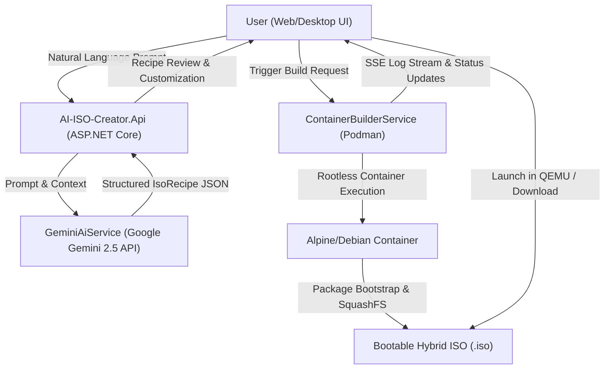

# AI-ISO-Creator Architecture

## Overview
AI-ISO-Creator is designed around a clean, modular monolith architecture in C# (.NET 8), combining an API server, an AI processing engine, a containerized ISO build orchestrator, and a lightweight web-desktop frontend.

## Module Structure

- **AI-ISO-Creator.Core**:
  - Core domain models (`IsoRecipe`, `BuildJob`, `BuildLogEntry`).
  - `GeminiAiService`: Interacts with Google Generative Language REST APIs and provides deterministic offline fallback generation.
  - `ContainerBuilderService`: Orchestrates container lifecycle, builds the bootable ISO file system, monitors progress, and integrates with QEMU virtualization.
  - `Configuration`: Gemini model parameters and endpoints.

- **AI-ISO-Creator.Api**:
  - High-performance ASP.NET Core Minimal API endpoints.
  - Real-time Server-Sent Events (SSE) streaming (`/api/build/{id}/stream`).
  - Persistent user configuration management via `AppSettingsService` (`user_settings.json`).
  - Static file hosting for the modern frontend SPA located in `wwwroot`.

- **AI-ISO-Creator.Frontend (`wwwroot`)**:
  - Pure, dependency-free vanilla JavaScript (`app.js`) and modern CSS (`app.css`).
  - Interactive multi-step wizard: Prompt creation ➔ Recipe verification ➔ Live container console ➔ Completed ISO download & QEMU testing.

- **AI-ISO-Creator.Tests**:
  - xUnit test suite covering Gemini recipe creation, fallback behaviors, recipe sanitation, and system tool checks.

## Data Flow
1. The user inputs their desired OS characteristics in natural language.
2. The API delegates the prompt to `GeminiAiService` using structured JSON schema instructions.
3. Gemini returns an `IsoRecipe` object containing distribution details, package lists, desktop environment settings, and system users.
4. The user reviews and optionally refines the recipe (either manually or via conversational AI refinement).
5. Upon confirmation, `ContainerBuilderService` generates a tailored `build.sh` script and executes a rootless Podman container.
6. The container installs packages, sets up credentials, compresses rootfs with SquashFS, configures BIOS/UEFI bootloaders, and produces a hybrid ISO via `xorriso`.
7. Real-time console logs are streamed to the frontend via SSE.
8. Once completed, the user can download the `.iso` image or boot it directly into a virtual machine with QEMU.
